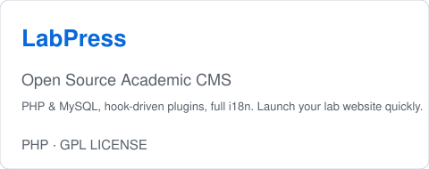

# HUI-MY CBBC

HUI-MY Center for Computational Biology and Chemistry

Computational Biology | Computational Engineering | Machine Learning

Website: https://www.huimy.top · Blog: https://blog.huimy.top · Email: suguohui_account@163.com

---

## Research Areas

| Computational Biology                                                                                   | GPU High-Performance Computing                                          | Scientific Software                                                            |
| ------------------------------------------------------------------------------------------------------- | ----------------------------------------------------------------------- | ------------------------------------------------------------------------------ |
| Molecular dynamics simulation, molecular docking, protein flexibility prediction, drug target screening | NVIDIA CUDA acceleration, large-scale scientific computing optimization | Python, C++, Web development, research automation tools, open-source ecosystem |

---

## Selected Projects

<table align="center">
<tr>
<td align="center">
<a href="https://github.com/GuiHui-huimy/LabPress">
<picture>
  <source media="(prefers-color-scheme: dark)" srcset="../assets/imgs/LabPress-dark.svg">
  
</picture>
</a>
</td>
<td align="center">
<a href="https://github.com/GuiHui-huimy/LabPress">
<picture>
  <source media="(prefers-color-scheme: dark)" srcset="../assets/imgs/LabPress-dark.svg">
  
</picture>
</a>
</td>
</tr>
</table>

<table align="center">
<tr>
<td align="center">
<a href="https://github.com/GuiHui-huimy/LabPress">
<picture>
  <source media="(prefers-color-scheme: dark)" srcset="../assets/imgs/LabPress-dark.svg">
  
</picture>
</a>
</td>
</tr>
</table>

Full project list: https://github.com/HUI-MY-CCBC

---

## Ecosystem

| Site          | URL                    | Description                         |
| ------------- | ---------------------- | ----------------------------------- |
| Portal        | https://www.huimy.top  | Introduction and navigation         |
| Blog          | https://blog.huimy.top | Technical notes and tutorials       |
| Community     | https://comm.huimy.top | Discussion and support              |
| Research      | https://lab.huimy.top  | Computational biology research      |
| Documentation | https://docs.huimy.top | Project docs and learning resources |

---

## Contact

Email: suguohui_account@163.com

HUI-MY CCBC — Computational Biology, Computational Engineering, Machine Learning
